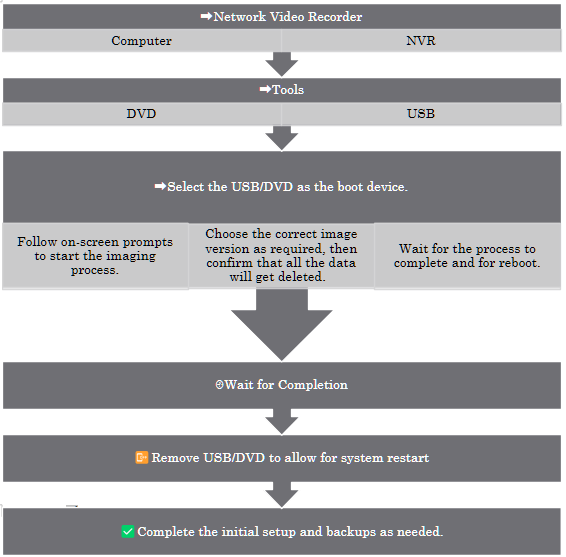

# Installation and Setup Manual

## Welcome

Action cameras are small, rugged devices designed to capture high-quality video and images in extreme conditions. They are often used for sports and adventure photography, featuring wide-angle lenses and robust waterproof and shockproof casings. Their compact size and durability make them ideal for capturing fast-paced and immersive footage.

-   {width="2.3957in" height="1.9654in"} **Smartphone cameras:** Modern smartphones are equipped with highly advanced camera systems that rival dedicated cameras in many aspects. Smartphone cameras are convenient and always accessible, enabling users to capture high-quality images and videos on the go. They offer features like multiple lenses.

## Camera Types

### Dome Cameras (Indoor)

Dome cameras are named for their dome-shaped housing, making them discreet and less noticeable. These cameras are typically mounted on ceilings or walls and offer a wide-angle view, ideal for monitoring large areas such as retail stores, offices, and warehouses.

### Bullet Cameras

{width="3.1201in" height="2.0807in"}

Bullet cameras, also known as cylindrical cameras, are characterized by their long and tapered shape. They are often used outdoors due to their weatherproof design.

### PTZ Cameras

Pan-Tilt-Zoom (PTZ) cameras are highly versatile and capable of covering large areas with a single device. These cameras can pan, tilt, and zoom, allowing for comprehensive surveillance.

### Wireless Cameras

Wireless cameras transmit video signals over Wi-Fi, eliminating the need for extensive cabling. They are easy to install and offer flexibility in placement.

### IP Cameras

Internet Protocol (IP) cameras send and receive data over a network, enabling remote viewing and monitoring from anywhere with an internet connection. They offer high-resolution video and advanced features such as motion detection, video analytics, and cloud storage.

Each type serves distinct security needs, ranging from home monitoring to business surveillance.

Basic operations such as powering on/off, using the viewfinder, and the
LCD screen.

**ISO** stands for International Organization for Standardization,
indicating the camera\'s sensitivity to light. Utilize a low ISO in
bright conditions and a high ISO in dim lighting.

Aperture refers to the opening in the camera lens through which light
passes, measured in F-stops. A lower F-stop means more light is let in,
while a higher F-stop is ideal for bright conditions and sharper focus.

A practical, step-by-step guide for camera installation teams working
with Camect, ExacqVision and Avycon Systems. This manual covers
essential procedures including system re-imaging, camera integration,
remote viewing setup, troubleshooting, and advanced software features.
Designed for technicians with hands-on experience, it delivers clear
instructions, best practices, and quick-reference workflows to ensure
reliable, professional surveillance deployments in any environment.

# Internet of Things

The **Internet of Things (IoT)** refers to the way everyday devices-like
smart thermostats, security cameras, and even printers-are connected and
able to communicate with each other. These smart devices collect and
share data to make our lives easier, from automating routine tasks to
personalizing our experiences, often without us having to lift a finger.

## All of this relies on strong connections

Whether wired or wireless, think of the network as the backbone of
IoT---a channel that lets devices talk to each other. In a typical
office, for example, you'll find a WiFi network connecting laptops and
computers, a separate network for printers, and remote connections that
link different office locations together, making it feel like everyone's
in the same room, even if they're miles apart.

Thanks to these networks, you can send a document from your computer to
the printer with a click, or cast a presentation from your laptop to the
conference room TV via Bluetooth, allowing everyone to share information
instantly. Networks also act as a security barrier: people inside the
office can access resources from the outside world, but outsiders can't
easily reach sensitive information inside---much like looking through a
one-way mirror.

## In short

IoT and the networks that support it are what make our modern, connected
lives possible, seamlessly linking people, devices, and information.
Networks in IoT systems are designed with security in mind, using
encryption and authentication to protect data and devices from
unauthorized access. They also allow for centralized management, making
it easier to monitor device health, update software, and enforce
security policies.

# []{#anchor-1}Network€¯Fundamentals 

{width="2.7291in"
height="4.0937in"}

**1€¯€¯What€¯Is€¯a€¯Network?**

-   A network lets multiple devices share data (docs, e€‘mail, video)
    through switches or WLAN APs.
-   Protocol "languages" (Ethernet, TCP, HTTP, SMTP) set the rules for
    how hosts talk.
-   Mastering the basics is foundational for any IT or networking
    career.

**2€¯€¯Network Types & Scale**

-   **SOHO€¯‡¢€¯SMB€¯‡¢€¯Enterprise**: rising device count and infrastructure
    complexity.
-   **LAN** (building€‘sized) vs **WAN** (connects LANs worldwide via
    service€‘provider backbones).
-   Switches, routers and APs remain the core building blocks at every
    scale.

> 

**3€¯€¯The€¯OSI 7€‘Layer Model**

The **OSI (Open Systems Interconnection) 7-Layer Model** is a framework
that standardizes how devices communicate over a network by breaking the
process into seven distinct layers. Each layer has a specific role,
working with the layers above and below to ensure data flows smoothly
from sender to receiver. Here's a simplified breakdown:

**The 7 Layers Explained**

*(From Bottom to Top)*

  ------------------ ---------------------------------------------------------------------------------------------------------- ---------------------------------------
  Layer              Key Role                                                                                                   Example Protocols/Technologies
  1\. Physical       Transmits raw bit streams (0s/1s) over physical media (cables, Wi-Fi)                                      Ethernet cables, Fiber optics, Wi-Fi
  2\. Data Link      Manages direct communication between devices on the same network. Adds MAC addresses and error checking.   Ethernet, MAC addresses, Switches
  3\. Network        Routes data between different networks using IP addresses.                                                 IP (Internet Protocol), Routers
  4\. Transport      Ensures reliable end-to-end data delivery (error-checking, flow control).                                  TCP (reliable), UDP (fast/unreliable)
  5\. Session        Establishes, maintains, and terminates connections between applications.                                   NetBIOS, RPC
  6\. Presentation   Translates data into formats applications understand (encryption, compression).                            SSL/TLS, JPEG, ASCII
  7\. Application    Provides interfaces for end-user applications (web browsers, email).                                       HTTP, FTP, SMTP
  ------------------ ---------------------------------------------------------------------------------------------------------- ---------------------------------------

Memorizing all the layers isn\'t important; understanding their
existence is. A layer is a setup partition often discussed by IT, useful
for detailed planning. Think of it like a biological environment:
microscopic life at the smallest level, trees and flowers at the
macroscopic level, and mountains and oceans at the largest level.
\"High-level\" refers to non-technical explanations.

**How Layers Work Together**

-   **Encapsulation:** Data is wrapped with headers/trailers as it moves
    down the layers. For example:

    -   A web request (HTTP) starts at Layer 7.
    -   Transport Layer (TCP) adds a header with port numbers.
    -   Network Layer (IP) adds source/destination IP addresses (Level
        3)
    -   Data Link Layer (Ethernet) adds MAC addresses (Level 2)
    -   Physical Layer sends bits over cables/fiber (Level 1)

-   **Example Stack:**\
    HTTP (Layer 7) †’ TCP (Layer 4) †’ IP (Layer 3) †’ Ethernet (Layer 2) †’
    Cable/Fiber (Layer 1)

**Key Concepts**

1.  **Layer Independence:** Each layer only interacts with the layer
    directly above or below. For example, the Transport Layer (TCP)
    doesn't need to know if data is traveling over Ethernet or Wi-Fi.
2.  **Headers/Trailers:** Each layer adds its own metadata (e.g., IP
    headers for routing, TCP headers for ports).
3.  **Real-World vs. OSI:** Modern networks (like the internet) often
    combine layers. For instance, TCP/IP merges Layers 5--7 into a
    single \"Application Layer.\"

**Why This Matters**

-   **Troubleshooting:** If your web page won't load, you can isolate
    the issue:

    -   No connection? Check Physical/Link layers (cables, Wi-Fi).
    -   Can't reach a specific site? Check Network/Transport layers
        (IP/TCP).

-   **Security:** Encryption happens at the Presentation Layer
    (SSL/TLS), while firewalls operate at the Network/Transport layers.

By understanding the OSI model, you can better grasp how data travels
across networks and diagnose issues systematically.

**4€¯€¯IPv4 Addressing Basics**

-   One 32€‘bit address = **network€¯ID + host€¯ID**.
-   Dotted€‘decimal (0€‘255 each octet) yields 4.29€¯billion possible
    addresses.
-   Subnet mask/CIDR bits separate the network from the host portion.

**5€¯€¯Subnetting, VLSM & Private Space**

-   VLSM lets you carve variable€‘size subnets, conserving addresses.
-   RFC€¯1918 private ranges (10/8, 172.16/12, 192.168/16) stay internal;
    routers hide them with NAT.
-   Broadcast (255.255.255.255) floods a LAN; multicast (224.0.0.0/4)
    delivers one€‘to€‘many efficiently.

**6€¯€¯TCP/IP Model (4€‘Layer)**

-   Link –¸ Internet –¸ Transport –¸ Application (often shown with an
    optional Physical layer).
-   Protocol highlights: Ethernet/PPP (Link), IP (Internet), TCP/UDP
    (Transport), HTTP/SMTP/SSH/etc. (App).

**7€¯€¯TCP vs€¯UDP**

  -------------- -------------------------------- -------------------------
  Connection     Oriented (three€‘way handshake)   Connectionless
  Reliability    Sequencing, ACKs, retransmits    "Best effort"
  Overhead       Higher                           Minimal
  Typical uses   File transfer, e€‘mail, web       Voice/video, DNS, games
  -------------- -------------------------------- -------------------------

**8€¯€¯TCP Handshakes & Flow Control**

-   **3€‘way SYN€¯†’€¯SYN€‘ACK€¯†’€¯ACK** starts a session; **4€‘way FIN/ACK**
    closes it.
-   Sequence numbers + sliding windows handle ordering, congestion &
    retransmissions.

**9€¯€¯More TCP Internals**

-   Dynamic window sizing boosts throughput on clean links, shrinks on
    error.
-   Forward ACK tells sender the next expected segment for efficient
    recovery.

**10€¯€¯Cisco CLI Primer**

-   Modes: **User EXEC †’ Privileged EXEC †’ Global/Interface Config**.
-   Secure remote access with SSH (hostname, domain, RSA keys, local
    user, line vty).
-   Always copy run start to persist changes.

**11€¯€¯Ethernet & Switching**

-   48€‘bit MAC: 24€‘bit OUI + 24€‘bit device ID.
-   Switch forwarding methods: store€‘and€‘forward (safe), cut€‘through
    (fast), fragment€‘free (middle).
-   MAC€‘learning builds a CAM table; unknown frames flood, known frames
    forward/filter.

**12€¯€¯VLAN Fundamentals**

-   VLAN = virtual LAN; isolates Layer€‘2 broadcast domains logically.
-   IDs 1€‘4094 (12€‘bit tag). Router or Layer€‘3 switch needed for
    inter€‘VLAN traffic.

**13€¯€¯VLAN Trunking**

-   802.1Q tagging lets one link carry many VLANs.
-   Native VLAN sends frames untagged for legacy compatibility.
-   *Router€‘on€‘a€‘Stick* uses one sub€‘interface per VLAN for routing.

**14€¯€¯Access Control Lists (ACLs)**

-   Ordered rules match traffic; **implicit€¯deny** at end.
-   Standard (source only) vs Extended (src/dst, protocol, port).
-   Wildcard masks (0€¯=€¯match exact, 1€¯=€¯"any") simplify IP ranges.

**15€¯€¯ARP Essentials**

-   Broadcast "Who has IP X?" †’ unicast reply with MAC.
-   Entries live \~30€¯s in cache (can be flushed).
-   Variants: RARP (MAC‡¢IP), GARP (gratuitous update).

**16€¯€¯DHCP in a Nutshell**

-   **DORA** cycle: Discover –¸ Offer –¸ Request –¸ ACK.
-   Leases renew at T/2; options supply gateway, DNS, etc.
-   Relay agents forward client broadcasts across subnets.

**17€¯€¯DNS Basics**

-   Zones hold records: **A**, **AAAA**, **CNAME**, **MX**, **PTR**.
-   Resolvers use recursion & root hints to find authoritative answers.
-   TTL controls cache lifetime; ipconfig€¯/flushdns clears locally.

**18€¯€¯Static€¯Routing (ip route)**

-   Explicit destination/mask + next€‘hop or exit€‘interface.
-   0.0.0.0/0 = default route. Use permanent to keep entry despite link
    state.

**19€¯€¯RIP v2 Overview**

-   Distance€‘vector; metric = hop count (max€¯15).
-   Split€‘horizon & route poisoning fight loops.
-   Timers: update 30€¯s, invalid/hold€‘down 180€¯s, flush 240€¯s.

**20€¯€¯Network Address Translation (NAT)**

-   **Static** 1:1, **Dynamic** pool, **PAT/Overload** many€‘to€‘one via
    port numbers.
-   Bidirectional NAT allows outside€‘initiated sessions if configured.

**21€¯€¯Time Synchronization (NTP)**

-   NTP (UDP€¯123) hierarchies: stratum€¯0 atomic †’ 1€¯†’€¯2€¯...
-   ntp server \<ip-or-pool\> on Cisco; check with show ntp status.

**22€¯€¯Syslog Fundamentals**

-   Message format = *facility*.*severity* (0€¯=€¯emerg ... 7€¯=€¯debug).
-   Mnemonic: **E**very **A**wesome **C**isco **E**ngineer **W**ill
    **N**eed **I**ce€‘cream **D**aily.
-   Central server aggregates logs; filter by severity to spot critical
    issues fast.

**How to Use These Notes**

1.  **Skim before labs** -- know which layer/protocol to troubleshoot
    first.
2.  **Make flashcards** -- e.g., "RIP max hops?" †’ *15*.
3.  **Revisit after practice** -- add personal examples (configs, pings,
    Wireshark captures).

# []{#anchor-2}[]{#anchor-3}How to Re-Image an ExacqVision NVR

Imagine transforming your ExacqVision NVR back to its pristine factory
state, ready to tackle new challenges or resolve stubborn software
issues. Re-imaging your NVR is like hitting the reset button, giving it
a fresh start. But remember, this process wipes out all existing data,
so make sure to back up your important files before diving in. Let\'s
get started on this exciting journey to restart your NVR!

**Step-by-Step Process**

-   Power off the NVR and connect a monitor, keyboard, and mouse.
-   Insert the ExacqVision recovery USB drive or DVD.
-   Power on the NVR and enter the BIOS/boot menu (usually by pressing
    F12 or Esc).
-   Select the USB/DVD as the boot device.
-   Follow the on-screen prompts to start the imaging process.
-   Choose the correct image version as required.
-   Confirm that you wish to proceed, acknowledging that all data will
    be erased.
-   Wait for the process to complete; the NVR will reboot automatically.
-   Remove the USB/DVD and allow the system to boot into the ExacqVision
    OS.
-   Complete the initial setup, including network configuration and
    license activation.
-   Restore configuration and video backups as needed.

# []{#anchor-4}Adding a New Camera

When performing a fresh installation we will add new cameras. The
process is analogous to adding new controllers to an Xbox. This includes
both the physical site and through the ExacqVision MAP. This setup
allows for real-time monitoring, alarms, and AI detection provided by
ExacqVision. Maintaining a consistent method for adding new devices will
ensure a clean and easy-to-navigate final setup.

**Adding New Camera and Replacing Camera on ExacqVision Map**

-   Open the ExacqVision Client and log in.
-   Navigate to the *Setup* tab.
-   Select the server, then go to the *IP Cameras* section.
-   Click *Add* and enter the camera's IP address, username, and
    password.
-   Ensure the camera shares the first three segments of its IP address
    with the server for successful
    integration[]{#anchor-5}[^*\[1\]*^](#fn1).
-   Click *Apply* and verify the camera connects.
-   Go to the *Maps* section, select the desired map, and drag the new
    camera onto the map layout.
-   Save changes.

# []{#anchor-6}Replacing a Camera

-   Remove the old camera from the map by right-clicking and selecting
    *Remove*.
-   Add the new camera as described above.
-   Drag the new camera onto the map in the desired position.
-   Update camera labels and settings as needed.
-   Save the map layout.

# []{#anchor-7}Avycon NVR

**Overview**

Re-imaging an Avycon NVR is used to restore factory settings or recover
from system corruption. This process deletes all data.

**Step-by-Step Process**

**How to Use the Avycon CVMS Manual Alarm Triggers**

The Avycon CVMS 2.0 software enables manual control of alarm relay
outputs for managing external devices such as lights and sirens,
enhancing security and enabling real-time
monitoring[]{#anchor-8}[^*\[1\]*^](#fn1).

**Key Functions**

-   Manually trigger alarm relay outputs to control external devices.
-   Customize triggers based on specific events or schedules.
-   Integrate with access control systems for enhanced entry monitoring.
-   Use intrusion detection for area monitoring.
-   Schedule alarm relay activation for local sirens or other devices.

## []{#anchor-9}[]{#anchor-10}Avycon CVMS 2.0: Playback, Backup, and Resource Management

**Playback Footage in Sync**

-   Select multiple cameras for synchronized playback.
-   Use the timeline to play back footage from the same time across
    selected cameras.

**Backup Footage**

-   Select the desired camera(s) and time range.
-   Click *Backup* and choose a local disk as the destination.
-   Confirm and monitor the backup progress.

# []{#anchor-11}Avycon Resource Management

-   Limit simultaneous playback sessions to avoid overloading the
    workstation.
-   Close unused streams and sessions when not needed.

**Time Slice by Event and by Tag**

-   *By Event*: Filter footage by motion or alarm events.
-   *By Tag*: Search video by user-created tags for quick retrieval.

**Step-by-Step: Searching by Date, Camera, and Event**

-   Open the *Playback* tab.
-   Select the camera(s) and date range.
-   Use the *Event* or *Tag* filters to narrow results.
-   Review the timeline for marked events.
-   Click on an event to play back the relevant footage.

[]{#anchor-12}Remote Viewing

How to Set Up an ExacqVision NVR for Remote Viewing

-   Connect the NVR to the network and ensure Internet access.
-   Open the ExacqVision Client and log in as admin.
-   Go to *System* \> *Network* settings.
-   Configure the NVR with a static IP address.
-   Set up port forwarding on the router for the required ExacqVision
    ports (default: 80, 443, 22609).
-   Register for Exacq cloud-hosted relay service for simplified remote
    access if available[]{#anchor-13}[^*\[1\]*^](#fn1).
-   Test remote connectivity using the ExacqVision mobile or desktop
    client from an external network.

**How to Set Up an Avycon NVR for Remote Viewing**

-   Connect the NVR to the network and ensure it has Internet access.
-   Assign a static IP address to the NVR.
-   Set up port forwarding on the router for HTTP, RTSP, and client
    ports.
-   Enable P2P/Cloud access in the NVR's network settings if available.
-   Scan the QR code in the mobile app or enter the NVR's serial number.
-   Test remote viewing from an external device.

**How to Troubleshoot an Avycon Camera Not Showing Up in NVR**

-   Ensure the camera and NVR are on the same network segment.
-   Check the camera's power and network connections.
-   Use the Avycon camera search tool to find the camera's IP address.
-   Confirm the camera's IP address matches the NVR's subnet.
-   Check for IP conflicts.
-   Ensure the camera's firmware is up to date.
-   Add the camera manually using its IP address and credentials.
-   Reboot the camera and NVR if necessary.

**How to Set the IP Address in an Avycon Camera**

-   Connect the camera to the network and power it on.
-   Use the Avycon IP search tool or access the camera's web interface
    from a PC.
-   Log in with the default credentials.
-   Navigate to *Network Settings*.
-   Assign a static IP address that matches the NVR's subnet (first
    three segments should match)[]{#anchor-14}[^*\[1\]*^](#fn1).
-   Save and reboot the camera.
-   Verify connectivity by pinging the camera's IP address from a PC.

# []{#anchor-15}Camect Hub Installation & Configuration Guide

## []{#anchor-16}1  Purpose & Scope

This guide standardizes the installation and commissioning of Camect
Smart Camera Hubs across Integrated Security Consultants (ISC) customer
sites---ranging from K€‘12 campuses to high€‘throughput facilities such as
the Coca€‘Cola bottling plant. It is written for field technicians who
physically install cameras and bring new sites online. Follow these
steps exactly to ensure reliable video capture, alerting, and Central
Station integration.

Important  ISC's reputation rests on zero€‘downtime security coverage.
Deviations from this playbook require written approval from the Project
Engineer of Record (PER).

## []{#anchor-17}2  Pre€‘Installation Checklist

+------+--------------------------------------------------------------+
| -    | -   Confirm work order, camera schedule, and floor plans are |
|      |     in ServiceNow ticket.                                    |
+------+--------------------------------------------------------------+
| -    | -   Verify PoE switch ports, patch panels, and power outlets |
|      |     are live.                                                |
+------+--------------------------------------------------------------+
| -    | -   Obtain LAN IP range, DNS, gateway, and VLAN tags from    |
|      |     customer IT.                                             |
+------+--------------------------------------------------------------+
| -    | -   Confirm outbound ports 443 (TCP) and 554 (TCP/UDP) are   |
|      |     permitted to ISC NOC for Immix.                          |
+------+--------------------------------------------------------------+
| -    | -   Record camera MAC addresses for asset tracking.          |
+------+--------------------------------------------------------------+
| -    | -   Have a laptop with Chrome/Edge, USB€‘C Ethernet adapter,  |
|      |     and Cat€‘5e jumpers.                                      |
+------+--------------------------------------------------------------+

## []{#anchor-18}3  Unboxing & Power€‘Up

1.  Mount the Camect Hub in the designated IDF/MDF rack shelf (leave
    1 RU clearance).

2.  Patch Cat€‘5e/6 from Hub *LAN 1* to the security VLAN switch port.

3.  Connect the supplied 12€¯V€¯DC adapter to conditioned power (UPS
    recommended).

4.  Verify the LED ring illuminates solid blue within 30€¯s.

    -   If the ring is dark, reseat power; press the side power button
        once to start a soft boot.

Trouble Tip: A flashing red ring indicates the hub cannot reach the
internet---check VLAN ACLs.

## []{#anchor-19}4  Commissioning & Authentication

1.  On a technician laptop on the same VLAN, browse to home.camect.com †’
    V2 portal.

2.  Click Sign in with Google and use the site€‘specific ISC installer
    account (format isc.\<site€‘code\>@integratedsecuritycorp.com).

    -   Using the federated Google method prevents repeated email
        verifications.

3.  Accept the Camect Terms & Policy žœ Add Hub.

4.  The portal auto€‘discovers the Hub at 192.168.x.x. Select Activate.

5.  Leave default consent check€‘boxes enabled *(auto€‘password, optimized
    settings, email alerts)* unless instructed by PER.

6.  Rename the Hub following ISC naming schema: SITE€‘CODE_HUB€‘## (e.g.,
    COKE€‘ATL_HUB€‘01).

Note: Large campuses may use multiple hubs---record Asset ID sticker in
ServiceNow.

## []{#anchor-20}5  Network Configuration

  ------------------- ------------------ ----------------------------------------------------------------------------------------------------------------------
  Hostname            Matches Hub name   Visible in DHCP & NMS.
  Full Network Scan   Disabled           Prevents discovery of non€‘security IoT devices. Navigate Gear †’ Advanced †’ Scan local network -- uncheck both boxes.
  Static IP           Yes                Assign per cut€‘sheet; set DNS to customer internal resolver.
  ------------------- ------------------ ----------------------------------------------------------------------------------------------------------------------

## []{#anchor-21}6  Adding Cameras

## []{#anchor-22}6.1  Auto€‘Discovery (Default)

-   After commissioning, the Hub scans for ONVIF/RTSP cameras on the
    security VLAN.
-   Review discovered list žœ Add only those matching the work order.

## []{#anchor-23}6.2  Manual RTSP URL

Use when cameras are on separate subnets or require sub€‘stream
selection.

rtsp://\<username\>:\<password\>@\<IP\>:554/1 \# mainstream

rtsp://\<username\>:\<password\>@\<IP\>:554/2 \# sub€‘stream

Steps: Gear †’ Cameras †’ Add Camera †’ Stream URL. Paste URL žœ Save. Test
live view.

Tip: Click the *„¹ï¸ icon* under a camera name žœ Edit URL to switch
streams without re€‘adding.

7  Alert & Analytics Configuration

  ----------------------------- ------------------------------------------------------------------- ---------------------------------------------------------
  Object Detection              Limit alerts to *person*, *vehicle*, *animal* as required by SOW.   Gear †’ Alerts †’ Object List
  Notification Channels         Email (installer), messaging, (client), Camect App.                 Gear †’ Alerts †’ Send alerts by...
  Disable Auto€‘Suppression      Required for 24€¯Ã—€¯7 monitoring sites (schools).                     Alerts †’ Advanced †’ Do not auto€‘suppress similar events
  Areas of Interest & Ratings   Exclude sidewalks; enforce *no€‘loiter* zones.                       Camera View †’ Draw Box †’ Rating
  Time Constraints              Detect *package trucks* 07:00--18:00 only.                          Alerts †’ Time Constraints
  Loitering                     Alert if person stationary \>€¯20€¯s near entrance.                   Create *Thumbs€‘Down* rating (loitering=20€¯s)
  Line Crossing                 Trigger when vehicle crosses perimeter line †’ gate opens.           Camera View †’ Draw Red Line (double€‘click to flip)
  Sensitivity Mode              Improve thermal/night cameras; expect more false positives.         Alerts †’ Sensitivity Mode (per camera)
  Long€‘Distance Mode            Sporting fields, parking lots. Requires 4€¯K camera & added CPU.     Alerts †’ Long Distance Mode
  ----------------------------- ------------------------------------------------------------------- ---------------------------------------------------------

## []{#anchor-24}8  Clip Management & Evidence Export

1.  Hover Bell ðŸ”” to view unacknowledged alerts; click a timestamp to
    jump in Timeline.
2.  Drag brackets Œ©Œª to set start/end žœ Download (MP4) or Share.
3.  First€‘time share prompts Google Drive link creation---use the ISC
    service account.
4.  Option: Summarized Video for condensed evidentiary review.

## []{#anchor-25}9  Immix Integration (Central Station)

1.  Port€‘forward Hub WAN to 443 & 554 at customer firewall.
2.  In Immix: Add Site žœ fill address, customer code.
3.  Add Device žœ Type =Camect, WAN IP, Secure Port = 443, credentials
    (local Hub admin).
4.  Auto€‘Configure Cameras---pull list from Hub.
5.  Enable Alarms in Hub žœ Immix receives events; verify talk€‘down audio
    (press€‘to€‘talk \> 2€¯s).

## []{#anchor-26}10  Maintenance & Support

  ------------------------------ -------------------------- ------------------------------------------
  Review resource usage bar      After adding each camera   Hub Dashboard
  Submit bug report              As needed                  Gear †’ System †’ Report Bug (attach logs)
  Firmware update                Quarterly release          ISC Change Control SOP 16€‘Q
  Verify alert delivery to NOC   Post€‘install & monthly     Immix event log
  ------------------------------ -------------------------- ------------------------------------------

## []{#anchor-27}11  Post€‘Installation QA Checklist

-   All cameras display live video in Camect UI.
-   Correct site & zone names appear in Immix.
-   Test *person* detection alert and verify email to
    noc@integratedsecuritycorp.com.
-   Download sample clip and confirm playback on technician laptop.
-   Asset tags entered in ServiceNow ticket & signed off by PER.

## []{#anchor-28}12  Troubleshooting Quick Reference

  ---------------------------- ------------------------- -------------------------------------------------------
  Blue ring absent             No power or bad adapter   Check UPS outlet, press power button.
  Hub not discovered           VLAN mismatch             Use laptop on same subnet; manually browse to Hub IP.
  Excess false alerts          Sensitivity mode on       Disable per camera; review lighting.
  Immix not receiving alarms   Port 443/554 blocked      Confirm NAT/ACL; test with telnet.
  Talk€‘down one€‘way            Mic muted in Immix        Check PC audio permissions; verify Hub FW ‰¥ x.x.
  ---------------------------- ------------------------- -------------------------------------------------------

KamTech Tutorials

Entrapass GoPass Mobile Credentials Training: Programming and Use

Mobile Access Setup

🔑 EntraPass GoPass enables mobile credentials by requiring users to
enter a passcode, select sites, and add doors to favorites for quick
access.

Card Holder Management

👤 Adding new card holders in EntraPass GoPass involves inputting
essential details like name, email, card type/number, end date, and
assigning the appropriate access level.

Application Activation

📱 Activating EntraPass GoPass requires users to check for an activation
email, download the app via the provided link, and use mobile
credentials to complete the setup process.

Replacing lithium battery on KT 1 controller

Battery Replacement Procedure

🔧 To replace the lithium battery on a KT-1 controller, first remove it
from the faceplate by gently pulling, then pinch the clamp at the end
and gently push it out, repeating for all four clamps.

*Kantech Onboard Guide*

*Integration and Cost Savings*

*🔗 Kantech EntraPass Corporate Edition integrates access control with
video recording on exacqVision recorders, providing hardware, power, and
cooling cost savings.*

*Installation and Configuration*

*🔑 To install, log into the restricted user account, then the
administrator account (password: admin256) on the exacqVision recorder
and follow the installation walkthrough.*

*🎯 Configure backup targets by launching the Workstation application,
logging in with admin admin256, clicking Options \> Backup Scheduler,
and changing the default location to a removable media or network
share.*

*Registration and Cleanup*

*📋 Kantech certified technicians must perform the registration process
by providing the system serial number to Kantech.*

*🗑️ After installation, delete the Interpass web icon and Interpass
folder to free up over 1 GB of space on the exacqVision server.*

Kantech Access Control, exacqVision

Integration and Control

🔐 2 integrates with Kantech Entrapass access control system, enabling
users to control doors and locks directly from the live view page.

🎛️ Users can perform access control functions like arming, unlocking,
disabling, bypassing, and activating through the live view page and
camera links feature.

Event Management and Visualization

🔗 The event linking page allows users to associate access control
inputs with events, triggering actions like video recording or
notifications when device status changes.

🗺️ exacqVision\'s mapping function provides a clear visual
representation of access control status, showing which entryways are
triggered, unlocked, or armed.

Configuration

🔧 The add access control section in the configuration tree displays
available functions, including relays, door locks, and readers, based on
the connected access control device.

Converting ioProx cards from 24 to 32 bits

Card Encoding and Compatibility

🔐 ioProx cards are dual encoded with a 26-bit number and an extended
family code for 32-bit compatibility, enabling flexible usage across
different systems.

Conversion Process

🔄 To convert all cards to a specific 32-bit extended family code,
navigate to Options \> Display Format, select 32-bit global card format,
and choose Yes to create a backup and perform the conversion.

🔁 For auto-converting ioProx cards from 24-bit to 32-bit, select 32-bit
global card format in Options \> Display Format, choose No to convert
all cards, then Yes for auto-conversion, requiring an initial access
denied swipe for each card.

System Flexibility

🔓 The dual encoding feature of ioProx cards allows for seamless
transition between 26-bit and 32-bit systems without replacing existing
cards.

User Experience

👤 During the auto-conversion process, users will experience a one-time
access denied message, which is automatically corrected on the
subsequent card swipe.

Kantech email server

Configuration

1.  🖥️ To configure a Kantech email server, gather essential SMTP server
    information including IP address, domain name, email port, sender,
    encryption, authentication, username, and password.
2.  🔒 SmartLink must be installed and running to enable sending emails
    from triggers or reliance using the SmartLink email tab in the
    devices application.

Functionality

1.  📊 Automatic report emails can be sent using the email reports tab
    in the devices application for Entry Pass and Corporate editions,
    while the Global edition uses a separate email reports tab.
2.  🧪 Test the email server configuration by entering a valid email and
    test area, then clicking the test button to ensure proper setup and
    receive an \"OK\" confirmation message.

EntraPass IP communication Troubleshooting

Troubleshooting Process

1.  🔍 Gather critical information including IP address, subnet,
    gateway, protocol, MAC address, and broadcast configuration to
    effectively diagnose and resolve IP communication issues.
2.  🌐 Verify the enterprise gateway\'s communication status as the
    first step, which can reveal issues like \"gateway not connected\",
    \"IP device disabled\", or \"failed to reach IP device\".

Technical Checks

1.  🖥️ 

Test TCP port 1802 using the telnet function from a laptop to determine
if communication is possible and identify potential antivirus or
firewall blockages.

2.  🔄 If controllers communicate initially but then reboot and fail to
    reconnect, it likely indicates incorrect information programmed in
    \"devices connection\".
3.  🏷️ Ping the controller\'s IP address before and after disconnecting
    it to identify potential IP conflicts if responses continue after
    disconnection.

12 things you may not know about EntraPass

Advanced Features

1.  🔧 EntraPass offers a driver builder software for creating custom
    card drivers, accessible via Start \> All Programs \> Kantech Server
    \> Database Utility.
2.  🔄 The software supports free upgrades to any build within the same
    version and provides self-extracting backups containing version and
    edition information.

Efficiency Tools

1.  Œ¨ï¸ Shortcut keys for quick access to various features are pre-built
    into EntraPass, viewable in the Help menu.
2.  🖨️ A printer icon for card list printing and automatic time
    synchronization in Corporate and Global editions enhance user
    efficiency.

Maintenance and Support

1.  🛠️ EntraPass includes a database utility tool for running scans,
    correcting mistakes, cleaning the database, and removing deleted
    items, alongside a how-to section with instructional videos in the
    Help menu.

## Driver Builder

### Card Driver Creation Process

🔢 ****Driver Builder**** requires entering the ****exact card
number****, clicking \"scan to match\", and swiping the card to create a
driver for a ****standard card**** or ****legacy controller****.

🧮 The ****raw data**** from the card must be matched with its
****binary representation**** in Notepad, obtained by converting the
****card number**** and ****site code**** using the ****Windows
calculator****.

### Card Data Structure

🃏 In the ****Wiegand format standard****, the ****8-bit site code****
(hexadecimal for alpha characters) is displayed on the left, while the
****16-bit card number**** (binary) is on the right.

### Legacy Controller Support

🏛️ ****Driver Builder**** supports creating drivers for ****legacy
controllers**** by selecting the appropriate option and following a
similar process to standard card driver creation.

ioSmart 485

Reader Capabilities

🔖 ioSmart card readers can read 6 card types, while multi-technology
readers support 9 card types, including additional 125 kHz formats.

Connectivity and Installation

🔌 ioSmart readers connect to controller\'s D0 and D1 terminals and can
be wired in daisy chain or star pattern configurations.

Configuration and Management

🖥️ Reader serial numbers can be retrieved through the operation
controller or devices controller interfaces, enabling easy
identification and management.

Input/Output Flexibility

🔧 ioSmart readers offer configurable inputs and outputs, including LED
inputs, lock outputs, and open collector relay outputs, with up to 750
mA capacity for relay/lock outputs.

Advanced Features

Œ¨ï¸ ioSmart readers can include an optional keypad, with the ability to
define inputs and outputs directly from the reader interface.

KT 1 standalone

Security and Configuration

🔐 The KT-1 requires firmware version 2.0.14 or above for standalone
mode and demands encrypted installer or operator login creation, which
cannot be reset, emphasizing the importance of password retention.

🛠️ Standalone mode allows selection of two card formats from 31 built-in
drivers, adjustment of PIN digits (4-6), and entry of I/O smart serial
number for communication setup.

Functionality and Integration

🚪 Users can configure doors, set specific daily/weekly/monthly/annual
actions, and integrate with alarm systems using keys exclusive to the
door tab.

Data Management

💾 The system prompts for automatic backup of card and schedule
information, which is strongly recommended for data preservation and
programming purposes.

Activation Process

📋 Customer and installer information must be entered to activate the
KT-1, either through the web configuration page, Kantech website, or by
contacting technical support.

ioSmart Wiegand

Reader Compatibility

🔑 IoSmart reader supports multiple card technologies including io
smart, Mifare plus, SSF, can tech, and Mifare classic, while Multi tech
reader adds compatibility for HID 125 kHz and Tak io procs cards.

Configuration

🔧 When connecting a reader for the first time, select the output format
using beep codes: 3 beeps for SSF, 2 for XSF, 1 for 26 bit, and 34 bits
for 34 bit format.

Data Processing

🔒 Multi tech readers send raw HID data to the controller for
decryption, requiring the correct reader type to be selected under
devices controller for proper functionality.

Factory Defaulting Intevo

Factory Default Process

1.  🔄 To factory default an Intevo unit, press F8 repeatedly during
    startup until reaching the \"Repair Your Computer\" page, then enter
    the restoration password \"1-2-3-4-5\" to initiate the recovery
    process.
2.  💾 Before defaulting, backup critical data including archives, video
    events, and client version information using the Exact Vision
    Client\'s Backup Scheduler.

System Configuration

1.  🖥️ After defaulting, reconfigure the unit by selecting language,
    accepting licensing, setting computer name, time zone, and entering
    static IP addresses for each Ethernet adapter in the First Boot
    Wizard.

Post-Default Steps

1.  🔍 Verify and upgrade if necessary the versions of H DVR (or Exact
    Vision) and Entry Pass after completing the factory default process.
2.  🔒 Record essential information before defaulting, including
    computer name, workgroup/domain, and IP information for both
    Ethernet adapters using ipconfig /all command.

Basics of Access Control

Core Components

🔐 Access control systems comprise five key elements: an access
controller, reader/keypad, door contact, door strike/magnetic lock, and
request to exit unit.

🧠 The access controller acts as the system\'s brain, continuously
monitoring door status and granting access based on programmed
credentials.

Functionality

🚪 Door strikes or magnetic locks physically secure entrances, releasing
only when the controller grants access.

👋 Request to exit units, utilizing motion infrared detectors or manual
buttons, allow credential-free egress from controlled areas.

Security Mechanism

🔢 Access controllers use decryption templates to translate binary
reader data into card numbers, granting entry if the decryption matches
the card\'s encryption.

How to blank the database for Special, Corporate or Global Edition

Database Management

1.  🗑️ 

To blank the database for EntraPass Special, Corporate, or Global
Editions, delete all files in the \"C:\\Program Files
x86\\Kantech\\Server SE/CE/G\\Data\" folder and replace them with files
from the \"Server uncore C\\Data SRC\" folder.

2.  🔄 This process applies to all Editions and versions of EntraPass,
    providing a universal solution for database reset across different
    software variants.

Troubleshooting

1.  🛠️ Blanking the database is a crucial troubleshooting step when
    facing database corruption or when customers are locked out of the
    system, offering a clean slate for system recovery.

Software Specifics

1.  🔒 The instructions are specific to Kantech\'s EntraPass software
    and its Server SE/CE/G versions, highlighting the importance of
    following manufacturer-specific guidelines for security management
    systems.

Post-Reset Procedure

1.  🖥️ After blanking the database, users must close the folder and
    restart the EntraPass software to access the system with the newly
    created blank database, ensuring proper initialization of the reset
    environment.

## How to integrate a Neo panel to a KT-400 or KT-1 with version 4 communicator

### Integration Requirements and Setup

🔧 ****Minimum firmware versions**** required: KT-400 (1.17 rev 1 or
1.23+), KT-1 (1.03+), Neo panel (1.10+), and TL-28R module (4.10+) for
successful integration.

🔌 Hardware connection involves linking the ****Neo panel to TL-28R
module via Ethernet****, which then communicates with KT-400/KT-1 over
Ethernet network.

### Programming and Configuration

🖥️ Program Neo panel by accessing ****subsection 382****, selecting
option 5 for alternate communications, and ensuring \"yes\" is selected.

🌐 Configure TL-28R module\'s IP address in Neo panel by activating
numbers 3 and 5 in ****subsection 851 and 663****, then entering
KT-400/KT-1\'s static IP in subsection 693.

### Functionality

🔐 Enable ****arm/disarm from door**** by selecting door in Entrapass,
enabling multi-swipe, choosing double-swipe action for arm/disarm, and
selecting partition to control.

How to factory default a KT-400

Factory Default Process

1.  🔄 

To factory default a KT-400 to DHCP: remove jumpers JP 2 and JP 3, press
reset button for 5 seconds, wait for heartbeat LED to go solid then
flash.

2.  🔒 

For static IP factory default: keep only jumper JP 2 on, press reset
button for 5 seconds, observe heartbeat LED flashing with 3 long pulses
twice.

Post-Reset Configuration

1.  🔌 After factory defaulting to static IP, replace jumper JP 3 before
    saving configuration to prevent reverting to static IP.

LED Indicators

1.  💡 Heartbeat LED behavior during reset: goes solid temporarily, then
    flashes to indicate process completion.

Reset vs. Factory Default

1.  🔁 Reset process for both DHCP and static IP is identical to factory
    default procedure for respective configurations.

## How to create and manage access levels

### Access Management

🔑 ****Create new access levels**** by selecting schedules for each
door, allowing granular control over ****user access rights**** across
different areas of a facility.

🔄 ****Modify access level schedules**** in the \"definition schedule\"
section to update access rights for all associated doors simultaneously,
streamlining ****security management****.

### Card Administration

💳 ****Add new cards**** to the system by assigning them names, card
numbers, and specific access levels, enabling ****customized user
permissions****.

🚪 ****Swipe cards at readers**** to test functionality and receive
status messages, including \"****access denied card unknown****\" for
unregistered cards.

### Efficient User Management

👤 ****Quickly add new users**** by right-clicking on access denial
events and selecting \"edit\" then \"card,\" automatically populating
the card number field for ****streamlined onboarding****.

How to create and manage holidays

Holiday Management

1.  🗓️ Create holidays in Enterp Pass software by navigating to
    Definition \> Holiday, entering name and date, selecting recurring
    option, and choosing holiday type for different schedules.
2.  🔄 Selective holidays can be applied to specific sites or
    connections, while recurring holidays automatically repeat annually
    on the same date.

Schedule Integration

1.  📅 Create holiday schedules by going to Definition \> Schedule,
    applying different schedules to various holiday types and dates.
2.  🚪 Test holiday-schedule relationships by defining a holiday and
    checking the operation door to observe schedule effects.

System Indicators

1.  🔍 Detect active holidays in the system by looking for an orange dot
    in the bottom left corner, which displays \"Holiday detected\" on
    mouseover.

How to create and manage holidays

Holiday Management

1.  🗓️ Create holidays in Enterp Pass software by navigating to
    Definition \> Holiday, entering name and date, selecting recurring
    option, and choosing holiday type for different schedules.
2.  🔄 Selective holidays can be applied to specific sites or
    connections, while recurring holidays automatically repeat annually
    on the same date.

Schedule Integration

1.  📅 Create holiday schedules by going to Definition \> Schedule,
    applying different schedules to various holiday types and dates.
2.  🚪 Test holiday-schedule relationships by defining a holiday and
    checking the operation door to observe schedule effects.

System Indicators

1.  🔍 Detect active holidays in the system by looking for an orange dot
    in the bottom left corner, which displays \"Holiday detected\" on
    mouseover.

Creating Backups in Corporate and Global Edition

Backup Management

1.  🔄Entrapass Corporate and Global Edition offers flexible backup
    options including data, archive, In-N-Out, and video types, with
    customizable frequency settings (now, weekly, monthly, daily) and
    location choices (default or specific folder).
2.  🗂️ The system supports nested backups, allowing users to create
    backups within backups for enhanced data organization and security.

Restoration Process

1.  🔙 Restoring backups is streamlined through the Server \> Backup \>
    Restore Data path, with a simple folder selection process and
    automatic event generation upon successful restoration.

System Features

1.  📁 Default backups are stored in C:\\Program Files\\Program Files
    x86\\Contact Ser_CE\\Backup with folders named using a \"D\" prefix
    followed by date and time.
2.  📊 

The platform provides real-time event generation for backup and restore
processes, ensuring users are informed of progress and potential issues
throughout the operation.

Creating a KT-400 IP site

Network Configuration

🌐 KT-400 IP site setup requires selecting a corporate Gateway,
specifying the number of controllers, and choosing between \"secure IP
kt4 100\" for KT-400 or \"secure IP IP Link\" for IP Link as the
connection type.

🖧 For non-DHCP configurations, enter a private IP address with subnet,
mask, and gateway, then select either TCP or UDP protocol and specify
the communication port.

*Installing a Remote Workstation*

*Installation Requirements*

*🔑 Remote workstations require additional licenses beyond the 2
included in Global Edition and 4 in Corporate Edition of KC Entropass
software.*

*🖥️ The remote workstation must be the exact same version as the server,
with firewall exceptions for TCP ports 18000, 18112, and 18101 on both
machines.*

*Setup Process*

🔢 Before installation, select the workstation in the registration
window and note the workstation installation code for use during setup.

🔗 After installation, register the workstation to the server using the
server\'s TCP/IP address or domain name, authentication password
(default: canch), and workstation installation code.

Access and Operation

🔐 To access the remote workstation, click the login button and enter
username and password when the workstation is running.

Hard resetting a KT-400 or IP-Link

Hardware Reset Procedures

🔧 Hard resetting a KT-400 requires removing JP2 and JP3, pressing reset
for 2 seconds, waiting for heartbeat blinking, replacing AP2, and
repeating reset process.

🔌 To default an IP-Link, place jumpers between PGM1-I1 and PGM2-I2,
wait for rapid heartbeat flash followed by solid light, then remove
jumpers.

Network Configuration

🌐 KT-400\'s default IP is 192.168.1.2, with laptop configured to
192.168.1.3 for setup.

š™ï¸ Configuring KT-400 involves entering server IP/domain, disabling DHCP
if unused, setting local IP, subnet mask, gateway IP, DNS, and selecting
UDP/TCP protocol and port.

Troubleshooting

🔍 Successful communication with Inass software is indicated by a solid
heartbeat followed by three Define a new card in Special Edition

Card Management

🔑 Special Edition software allows adding new cards via the \"user
card\" menu by entering a card number or swiping the card to generate an
\"access denied\" event.

📸 Right-clicking on a card enables adding a picture from file, which
will display when the card accesses a door.

Access Control

🔐 The \"access level\" setting determines card privileges, ranging from
\"none\" (no access) to \"always valid\" (24/7 access to all doors).

³ Setting a \"card expiration date\" automatically deletes the card on
the specified date, while changing the \"card state\" to \"expired\"
deletes it immediately.

How to send email notifications for EntraPass events

Email Notification Setup

🔧 Ensure Smart Link is running and communicating with the server, and
the email server doesn\'t require authentication or face antivirus
blocking.

📧 Create an email task in the Definition Task Builder for Smart Link,
specifying from address, subject, and body with event text, date, and
time in a specific format.

Event Triggering

🔔 Configure the event trigger by linking it to a specific event,
selecting the door component, and specifying either a single door or
trigger group.

Troubleshooting

🔍 Check system and operator logs for concurrent login and Smart Link
transactions to verify successful email sending.

📊 Validate email sending by reviewing the Smart Link transaction list
for successful sends and confirming receipt in the recipient\'s email
account.

How to configure alarms and sounds on door forced open in EntraPass

Alarm Configuration Process

1.  🔧 Configure alarms for door forced open events in EntraPass through
    5 key steps: system event parameter, system instruction, multimedia
    device sound, alarm desktop setup, and workstation alarm settings
    verification.
2.  🚪 The \"door first open\" event is selected under \"enterprise
    events\" in the event parameter, linked to a specific door and
    instruction, with an alarm sound assigned higher priority and a
    specific wave file.

Alarm Desktop Setup

1.  🖥️ Set up the alarm desktop by right-clicking, selecting properties,
    relabeling as \"alarm desktop\", and configuring it to display both
    event and message screens.

Alarm Settings and Behavior

1.  ° Verify alarm settings for workstations, assigning higher priority
    alarm sounds with specific wave files, and set acknowledgment system
    delay to 1 minute and suspend delay to 1-60 minutes.
2.  🔔 

Generate an alarm by selecting the \"door first open\" event, choosing a
specific door and workstation, selecting an instruction, and saving,
with the alarm sound continuing until acknowledged.

*Different ways to add a card in EntraPass and getting a card list*

*Card Management Techniques*

1.  *🔑 EntraPass offers four methods to add cards: user card menu,
    desktop events, batch load operation, and CSV file import, with
    communication to the controller being crucial for card download.*
2.  *📊 The batch load operation allows for efficient addition of
    multiple cards simultaneously, though initially without assigned
    access levels or times.*

*Access Control Features*

1.  *🕰️ Cards can be configured with expiration dates and automatic
    deletion, enhancing security for temporary access scenarios like
    visitor management.*
2.  *🚪 *

*When adding cards, users can specify card types (e.g., \"security\"),
access levels (e.g., \"visitor\"), and time restrictions (e.g., 8am-4pm
Mon-Wed) for granular access control.*

*System Management and Auditing*

1.  *📋 EntraPass enables generation of a comprehensive user list
    including card numbers and access levels, exportable as a CSV file
    for auditing purposes.*
2.  *🔢 The system supports both 26-bit and 32-bit card number formats,
    maintaining consistency in side code and corner loop across
    formats.*

*Import CSV file in EntraPass Corporate*

*CSV Import Process*

1.  *📊 The CSV import/export feature in EntraPass Corporate allows
    importing or exporting card files saved in CSV format, enabling data
    sharing between applications like Excel or Notepad.*
2.  *🔢 When importing a CSV file, each field must contain a specific
    value format with predefined or custom patterns that include card
    access group, card type fields, and must identify which column
    contains access levels.*

*Data Validation and Formatting*

1.  *🔐 The card type must be validated first, followed by the card
    access group and access level, and schedules must be created using
    military time format (e.g., 0800 to 1700 hours).*
2.  *📅 Up to ten fields of card information can be imported, including
    start date, card status, PINs, and other relevant data.*

*File Preparation*

1.  *💾 The CSV file must be saved as a comma-separated value file, with
    the file path located and selected in the EntraPass software,
    matching the format of the predefined or custom pattern used.*

## Elevator setup with KT-400

### Elevator Control Setup

🛗 ****KT-400**** requires either ****two KT module RL8**** or ****one
KT module output 16**** for elevator control, with ****additional 12V 1A
power supply**** needed if SPI module draws over ****500mA****.

🏢 ****Maximum cab flow**** is ****64 floors**** with module RL8 and
****4 connected**** with output 16, while ****max cabs per
controller**** are ****32**** (RL8) or ****16**** (output 16).

### Software Configuration

🖥️ In ****EntraPass software****, define modules as elevator equipment
under ****Devices Controller \> Gateway \> Controller \> Kit Number \>
Package 400 tab****, specifying ****door numbers**** and ****relay
outputs**** for each cab.

🔓 ****Unlock schedules**** for floor groups are set in the ****Elevator
tab****, allowing access to specific floors based on predefined time
periods.

### Access Control

🔑 User access to floor groups is managed by creating ****new access
levels**** in the ****Users \> Edit Card**** section, enabling
controlled elevator usage based on individual permissions and schedules.

*How to install USB-485*

*Installation and Configuration*

1.  *🔌 Connect the USB-485 adapter to the KT 400 controller by linking
    x-, x+, and ground pins, then install the driver by updating it in
    the device manager using the provided installation package.*
2.  *🖥️ The USB-485 adapter appears as a COM port in Windows device
    manager, which must be selected in the software to establish
    communication with the KT 400 controller.*

*Software Setup*

1.  *🛠️ Configure the KT 400 controller in the Enterprise Special
    Edition software by defining the site, selecting direct RS232 or USB
    connection, and choosing the correct COM port.*
2.  *🔑 Define a card in the software by entering the card number
    detected by the driver when swiped, and assign an access level to
    grant permissions.*

*Testing and Functionality*

1.  *🚪 Test the system by swiping the card at the door or using the Rex
    button to verify proper unlocking and access granting
    functionality.*

**Chapter: Gentec Vendor Training -- CCTV, Security, and Alarm Systems**

**Overview of Gentec**

Gentec is a leading provider of advanced security and surveillance
solutions, recognized for its innovative products in video surveillance,
access control, and alarm management. Gentec's product suite is widely
used in commercial, industrial, and institutional environments, offering
scalable and integrated security platforms designed to protect people,
property, and data.

**Key Gentec Product Lines**

Gentec's most prominent products in the security sector include:

-   **Genetec Security Center**: A unified security platform that
    integrates video surveillance, access control, and automatic license
    plate recognition (ALPR).
-   **Omnicast**: An IP-based video management system (VMS) for
    surveillance cameras.
-   **Synergis**: An IP access control system.
-   **AutoVu**: Automated license plate recognition (ALPR) solution.
-   **Genetec Streamvault**: Security appliances and servers optimized
    for Genetec software.
-   **Genetec Mission Control**: Decision management system for incident
    response.
-   **Genetec Clearance**: Digital evidence management platform.

These solutions are modular and can be deployed individually or as part
of a unified platform.

**CCTV and Video Surveillance Systems**

**Omnicast -- Video Management System**

**Omnicast** is Gentec's flagship VMS, supporting a wide range of IP
cameras from various manufacturers. Key features include:

-   Centralized management of live and recorded video.
-   Advanced video analytics (motion detection, people counting,
    intrusion detection).
-   Scalability from small sites to enterprise deployments.
-   Redundant recording and failover support for maximum uptime.
-   Integration with access control and alarm systems.

**Installation and Configuration Best Practices:**

-   Ensure all cameras are on the same network segment as the Omnicast
    server for optimal performance.
-   Use Genetec-certified hardware for compatibility and support.
-   Configure camera streams for optimal resolution and frame rate based
    on site requirements.
-   Set up user roles and permissions within Security Center to control
    access to video feeds.

**Access Control Systems**

**Synergis -- IP-Based Access Control**

**Synergis** offers a flexible and scalable access control solution:

-   Supports a wide range of hardware controllers and readers.
-   Real-time monitoring of door status and cardholder activity.
-   Integration with Omnicast for video verification of access events.
-   Advanced credential management and visitor management modules.

**Key Setup Steps:**

-   Register controllers and readers within Security Center.
-   Assign access rights and schedules to cardholders.
-   Configure alarms and notifications for unauthorized access events.
-   Integrate with video for visual verification of access attempts.

**Alarm and Intrusion Detection**

Gentec's Security Center platform allows for unified alarm management:

-   Alarm monitoring from video, access, and external intrusion systems.
-   Customizable alarm rules and escalation procedures.
-   Integration with third-party alarm panels and sensors.
-   Automated event responses, such as camera pop-ups or door lockdowns.

**Alarm Configuration Tips:**

-   Define clear alarm priorities and response protocols.
-   Test alarm triggers and notifications regularly.
-   Use video verification to reduce false alarms and improve response
    accuracy.

**Automated License Plate Recognition (ALPR)**

**AutoVu -- ALPR Solution**

**AutoVu** enables automated detection and logging of vehicle license
plates:

-   Fixed and mobile ALPR camera options.
-   Real-time plate matching against watchlists.
-   Integration with parking management and law enforcement databases.
-   Automated alerts for suspect or unauthorized vehicles.

**Deployment Considerations:**

-   Position cameras for optimal plate capture (angle, height,
    lighting).
-   Regularly update watchlists and system firmware.
-   Ensure secure storage and access control for ALPR data.

**Unified Security Platform: Security Center**

**Genetec Security Center** brings together all Gentec systems into a
single interface:

-   Unified monitoring and management of video, access, ALPR, and
    alarms.
-   Customizable dashboards and reporting tools.
-   Role-based access and multi-site management.
-   Open architecture for integration with third-party systems.

**Operator Training Points:**

-   Familiarize with dashboard navigation and alarm monitoring.
-   Practice searching and exporting video footage.
-   Review incident management workflows and reporting tools.

**Popular Gentec Products Summary Table**

  ----------------- ------------------------------- ---------------------------------------------
  Product Name      Function                        Key Features
  Security Center   Unified security platform       Video, access, ALPR, alarms integration
  Omnicast          Video management system (VMS)   Multi-brand IP camera support, analytics
  Synergis          IP access control               Real-time monitoring, credential management
  AutoVu            ALPR system                     Fixed/mobile cameras, watchlist integration
  Streamvault       Security appliances/servers     Optimized for Genetec software
  Mission Control   Incident management             Automated workflows, response coordination
  Clearance         Digital evidence management     Secure sharing, case management
  ----------------- ------------------------------- ---------------------------------------------

**Best Practices for Gentec System Deployment**

-   **Network Planning**: Use dedicated VLANs for security devices to
    ensure performance and security.
-   **Regular Updates**: Keep all software and firmware updated for
    security and feature enhancements.
-   **User Training**: Provide ongoing training for operators and
    administrators to maximize system effectiveness.
-   **Documentation**: Maintain detailed records of system
    configuration, user access, and maintenance activities.
-   **Integration Testing**: Regularly test integrations between video,
    access, and alarm systems to ensure seamless operation.

**Troubleshooting and Support**

-   Use the Genetec Knowledge Base and support portal for
    troubleshooting guides and updates.
-   For hardware issues, verify network connectivity and power status
    before escalating.
-   Log all incidents and resolutions for future reference and
    compliance.

**Conclusion**

Gentec offers a comprehensive suite of security solutions that can be
tailored to a wide range of environments. Mastery of Gentec's unified
platform, combined with adherence to best practices in installation,
configuration, and operation, ensures robust protection and efficient
security management. Regular training and system reviews are essential
to keep security operations effective and up to date.

‚

**Chapter: Avigilon Vendor Training -- Newest CCTV, Security, and
Surveillance Products**

**Overview of Avigilon**

Avigilon, a Motorola Solutions company, is renowned for its advanced
security and surveillance technologies. The company focuses on
delivering high-definition video, AI-powered analytics, and unified
security platforms for enterprise, commercial, and public sector
environments. Avigilon's latest innovations emphasize automation,
proactive threat detection, and seamless integration.

**Newest Avigilon Product Lines**

Avigilon has recently expanded its portfolio with several cutting-edge
products that enhance security and operational efficiency:

-   **Avigilon Unity Platform**: A unified security platform integrating
    video, access control, and analytics.
-   **H6A and H6X Camera Series**: Next-generation AI-enabled cameras
    with advanced video analytics.
-   **Avigilon Alta (formerly Ava Security)**: Cloud-native video
    security and access control solutions.
-   **Avigilon Appearance Search„¢**: AI-powered search technology for
    rapid identification and tracking.
-   **Avigilon Control Center (ACC) 8**: The latest version of
    Avigilon's flagship video management software.
-   **Avigilon Video Intercom**: Touchscreen intercom with integrated
    video analytics.
-   **Avigilon Radio Alert**: Integration of video analytics with radio
    communications for instant notifications.

**CCTV and Video Surveillance Systems**

**H6A and H6X Camera Series**

Avigilon's H6A and H6X cameras represent the latest in high-resolution,
AI-powered surveillance:

-   **Resolutions up to 4K and 8K** for detailed video capture.
-   **Next-generation analytics** including unusual activity detection,
    facial recognition, and license plate recognition.
-   **Low-light and wide dynamic range (WDR)** capabilities for
    challenging environments.
-   **Onboard storage** and encrypted video streams for enhanced
    security.

**Installation and Configuration Best Practices:**

-   Position cameras to maximize coverage and minimize blind spots.
-   Use Avigilon's camera configuration tools to optimize image quality
    and analytics performance.
-   Ensure firmware is updated to leverage the latest AI features.
-   Integrate with Avigilon Unity or ACC 8 for centralized management.

**Cloud-Native Security Solutions**

**Avigilon Alta (Cloud Platform)**

Avigilon Alta delivers cloud-based video security and access control:

-   **Remote management** of video and access devices from any location.
-   **AI-powered analytics** for proactive threat detection and
    automated alerts.
-   **Scalable storage** with cloud archiving and redundancy.
-   **Mobile app support** for real-time monitoring and response.

**Deployment Considerations:**

-   Ensure reliable internet connectivity for uninterrupted cloud
    service.
-   Configure user roles and permissions for secure remote access.
-   Leverage Alta's open API for integration with third-party systems.

**Unified Security Management**

**Avigilon Unity Platform**

The Avigilon Unity Platform unifies video, access control, and
analytics:

-   **Single dashboard** for monitoring and managing all security
    devices.
-   **Integration with Avigilon and third-party hardware.**
-   **Automated incident detection** and workflow management.
-   **Comprehensive reporting and audit trails.**

**Operator Training Points:**

-   Familiarize with dashboard navigation and incident response tools.
-   Practice searching video footage using Appearance Search„¢.
-   Review system health and audit logs regularly.

**Advanced Video Analytics**

**Avigilon Appearance Search„¢ and AI Analytics**

Avigilon's Appearance Search„¢ technology allows operators to quickly
locate individuals or vehicles across multiple cameras and timeframes:

-   **AI-driven search** based on clothing, color, or vehicle type.
-   **Facial recognition** and license plate reading for rapid
    identification.
-   **Real-time alerts** for persons or vehicles of interest.

**Best Practices:**

-   Regularly update watchlists and analytic profiles.
-   Test analytics accuracy in various lighting and environmental
    conditions.
-   Use analytics data to inform security policies and deployment
    strategies.

**Access Control and Video Intercom**

**Avigilon Video Intercom**

The Avigilon Video Intercom combines access control with video
analytics:

-   **Touchscreen interface** for visitor management.
-   **Integrated camera** with AI analytics for identity verification.
-   **Remote door release** and two-way audio.

**Setup Recommendations:**

-   Install at primary entry points for maximum effectiveness.
-   Integrate with Avigilon Unity or Alta for unified management.
-   Configure event-based alerts for unauthorized access attempts.

**Popular Avigilon Products Summary Table**

  --------------------------- ------------------------------------- ---------------------------------------------
  Product Name                Function                              Key Features
  H6A/H6X Camera Series       AI-enabled surveillance cameras       4K/8K video, advanced analytics, WDR
  Avigilon Unity Platform     Unified security management           Video, access, analytics integration
  Avigilon Alta               Cloud-native security                 Remote management, AI analytics, mobile app
  Avigilon Control Center 8   Video management software             Advanced analytics, Appearance Search„¢
  Avigilon Video Intercom     Access control & visitor management   Touchscreen, camera, AI analytics
  Avigilon Radio Alert        Instant notifications                 Radio integration, real-time alerts
  --------------------------- ------------------------------------- ---------------------------------------------

**Best Practices for Avigilon System Deployment**

-   **Network Security**: Use secure VLANs and encrypted streams for all
    video and access devices.
-   **Regular Updates**: Keep all software and camera firmware current
    for optimal security and features.
-   **User Training**: Provide comprehensive training on analytics,
    search tools, and incident response.
-   **Documentation**: Maintain detailed records of device locations,
    configurations, and user access.
-   **Integration Testing**: Verify interoperability between cameras,
    access control, and analytics regularly.

**Troubleshooting and Support**

-   Utilize Avigilon's online knowledge base and support portal for
    troubleshooting guidance.
-   For hardware issues, check power, network connectivity, and firmware
    status.
-   Document and escalate unresolved issues to Avigilon technical
    support as needed.

**Conclusion**

Avigilon's latest products leverage AI, cloud technology, and unified
management to deliver proactive, scalable security solutions. Mastery of
these systems enables organizations to respond rapidly to threats,
streamline investigations, and maintain robust protection across all
facilities. Ongoing training and adherence to deployment best practices
are essential for maximizing the value and effectiveness of Avigilon's
security platforms.

‚

# []{#anchor-29}Floor Plan Wire Runs

## []{#anchor-30}Designing Wir

> \[ELECTRICAL PANEL\]

> ”‚

> ”œ”€”€”€\[POWER\]”€”€”€”€”€”€”€Office 1 (Outlet)

> ”‚ ”‚

> ”‚ ”œ”€”€”€”€”€”€”€Office 2 (Outlet)

> ”‚ ”‚

> ”‚ ”””€”€”€”€”€”€”€Conference Room (Outlet)

> ”‚

> ”œ”€”€”€\[DATA\]”€”€”€”€”€”€”€”€Server Room (Ethernet Switch)

> ”‚ ”‚

> ”‚ ”œ”€”€”€”€”€”€”€Access Point 1 (CAT6)

> ”‚ ”‚

> ”‚ ”””€”€”€”€”€”€”€Security Cameras (Coaxial/PoE)

> ”‚

> ”””€”€”€\[COMMS\]”€”€”€”€”€”€”€Telecom Room (Fiber Optic)

> ”‚

> ”””€”€”€”€”€”€”€Front Desk (Phone Line)

[]{#anchor-31}

## []{#anchor-32}Using AI to Calculate Distances

> Have made significant progress in automating parts of the runoff
> process. What about preventing miscalculations from the AI? The method
> uses source documents which I provide from the training manual, which
> grounds the AI in truth. Then I set guardrails to be factual. This

> uses **Perplexity AI Pro **(Uses best model from ChatGPT0, GPT 4.1,
> Gemini 2.5, Claude 3.5, decided by based on type of prompt).

> []{#anchor-33}Interpreting Blueprints

> Read Legend to Identify Devices

> €¢

> Set Scale: .25 in = 1 ft

### Prompt:

> **\"**For the building blueprint, count the number of smoke alarms,
> the number of rooms, the number of manual pull stations, the number of
> strobes**\"**

### Result:

> **Perplexity AI: **Here are the counts based on the provided building
> blueprints:

> **SMOKE ALARMS; 82**

-   **FIRST FLOOR: 18 rooms**
-   **SECOND FLOOR: 32 rooms**
-   **THIRD FLOOR: 32 rooms**

[]{#anchor-34}FLOOR PLAN - UNIT A1

Area: 939sqft Wire: 118ft

Area: 911sqft Wire: 93ft

Area: 822sqft Wire: 109ft

> []{#anchor-35}Area: 900sqft Wire: 63ft

> Area: 902sqft Wire: 40ft

> Area: 1027sqft Wire: 69ft

[]{#anchor-36}

### []{#anchor-37}^Room\ A1\ ^Room A2 ~Room\ A3\ ~^Room\ A4^

+---------+---------+---------+---------+---------+---------+---------+
| []{#an  | **Wire  | **Dete  | *       | **\#    | **Total | **Total |
| chor-38 | (ft)**  | ctors** | *Area** | Rooms** | B       | B       |
| }**Room |         |         |         |         | uilding | uilding |
| L       |         |         |         |         | Wire    | Area**  |
| abels** |         |         |         |         | (ft)**  |         |
+---------+---------+---------+---------+---------+---------+---------+
| A1      | 118     | 2       | > 939   | 44      | 5,192   | 41,316  |
+---------+---------+---------+---------+---------+---------+---------+
| A2      | 93      | 2       | > 911   | 10      | 930     | 9,110   |
+---------+---------+---------+---------+---------+---------+---------+
| A3      | 109     | 2       | > 822   | 1       | 109     | 822     |
+---------+---------+---------+---------+---------+---------+---------+
| B1      | 63      | 3       | > 900   | 92      | 5,796   | 82,800  |
+---------+---------+---------+---------+---------+---------+---------+
| B2      | 40      | 3       | > 902   | 9       | 360     | 8,118   |
+---------+---------+---------+---------+---------+---------+---------+
| B3      | 69      | 3       | > 1027  | 10      | 690     | 10,270  |
+---------+---------+---------+---------+---------+---------+---------+
| B4      | 118     | 3       | > 939   | 9       | 1,062   | 8,451   |
+---------+---------+---------+---------+---------+---------+---------+
| B5      | 93      | 3       | > 911   | 10      | 930     | 9,110   |
+---------+---------+---------+---------+---------+---------+---------+
| B6      | 109     | 3       | > 822   | 20      | 2,180   | 16,440  |
+---------+---------+---------+---------+---------+---------+---------+
| C1      | 68      | 3       | > 1178  | 20      | 1,360   | 23,560  |
+---------+---------+---------+---------+---------+---------+---------+
| C2      | 83      | 4       | > 1166  | 2       | 166     | 2,332   |
+---------+---------+---------+---------+---------+---------+---------+
| **      | >       | **31**  | > **1   | **227** | **1     | **21    |
| Total** | **963** |         | 0,517** |         | 8,775** | 2,329** |
+---------+---------+---------+---------+---------+---------+---------+

# []{#anchor-39} {#section-5}

